# Creative Coding - Process

**This file documents the development of the "co-presence" project by Francesco Le Touzé and Maurice Eggel as part of the Creative Coding course.**

Links:

[Github Pages](https://mauriceeggel.github.io/head-mmd-creative-coding/)  
[Figma](https://www.figma.com/board/dTHonVRdQGb8dKoEvwltzb/MD-Creative-Coding-interaction?node-id=0-1&p=f&t=FzfMFD18TMsBv58C-0)

As a first step, we created a mind map to extract various themes that interest us.

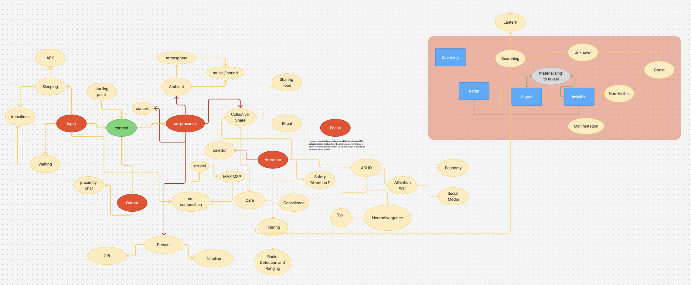
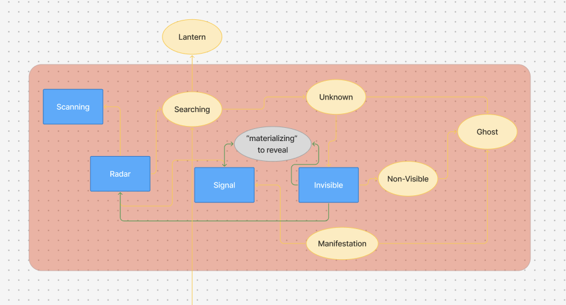
--> We settled on these terms.

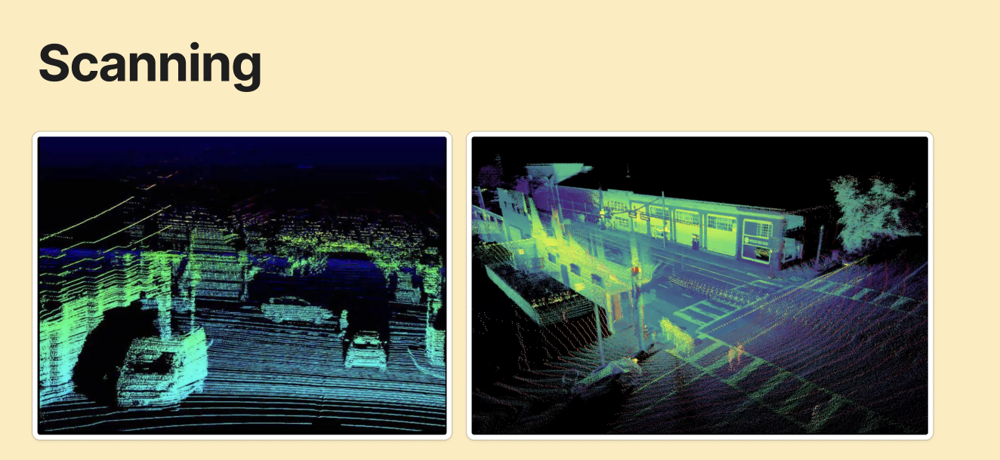
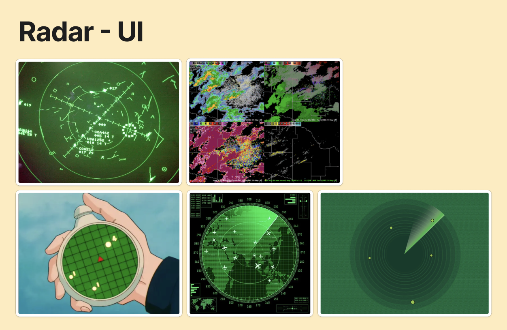
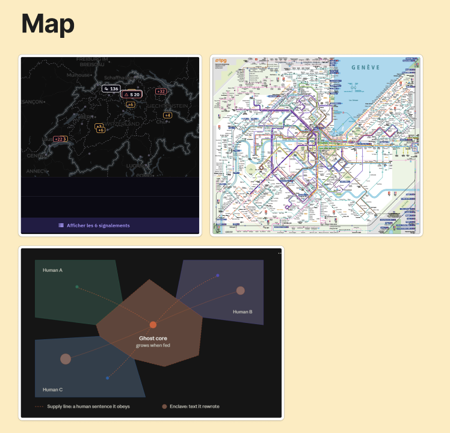

Several ideas caught our attention, particularly the concept of filtering different “signals.” This brought us to the *Dead Internet Theory*. From there, we began to wonder: what if we created a website where users had to distinguish humans from bots within a continuous feed?

We found it interesting to explore how, in an increasingly automated digital environment, the boundaries between human and artificial activity become blurred, and how our perception of authenticity is shaped by the signals we choose to trust or dismiss.

# Prototypes

From there, we began exploring different ideas:

## Idea 01 - Sound Room

[Sound Room](https://mauriceeggel.github.io/head-mmd-creative-coding/26-10-08-soundroom/)

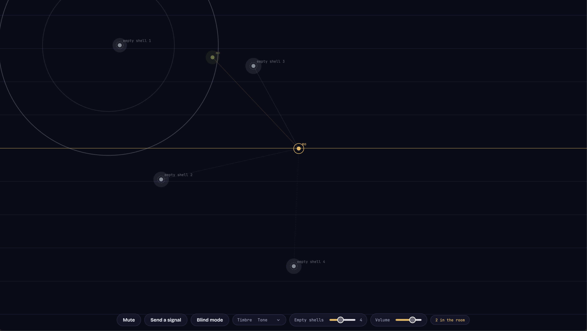

## Idea 02 - Lantern

[Lantern](https://mauriceeggel.github.io/head-mmd-creative-coding/26-10-14-lantern/)

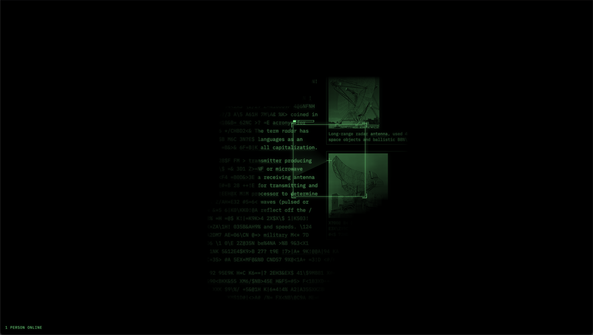

## Idea 03 - Map

[Map](https://mauriceeggel.github.io/head-mmd-creative-coding/26-10-15-bots-vs-humain/)

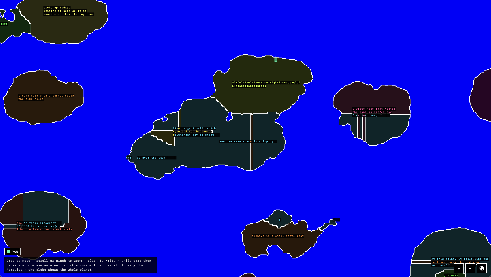
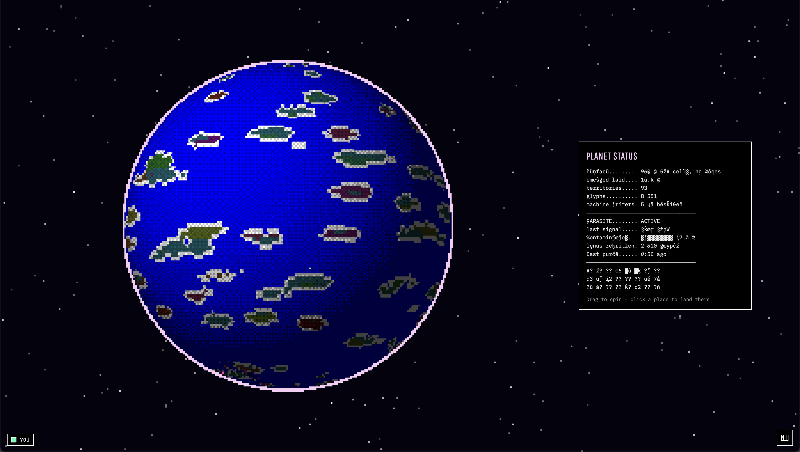

## Idea 04 - Stroke / Keystrok Radar

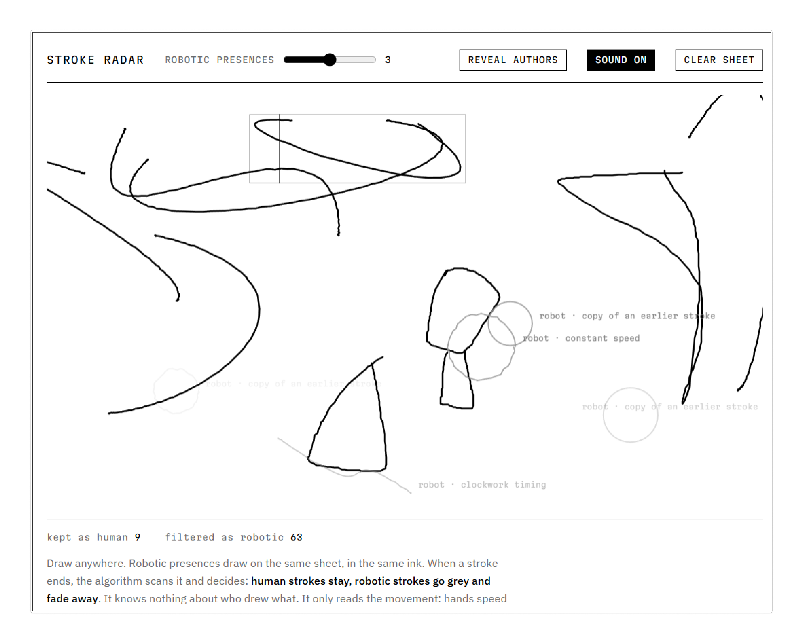
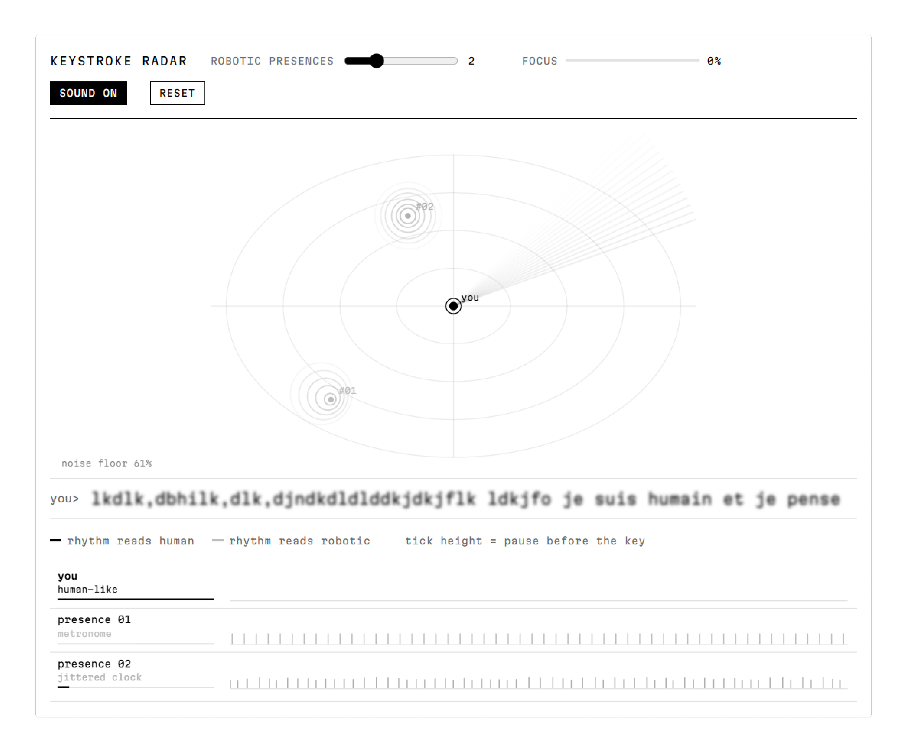
